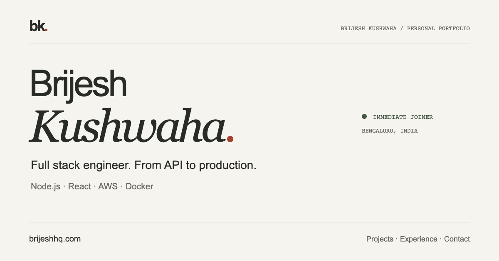

# Brijesh Kushwaha’s portfolio

[](https://github.com/bsingh6636/myPortfolio/actions/workflows/eslint.yml)

Live at **https://brijeshhq.com** — the personal site of Brijesh Kushwaha, full stack engineer (React, Node.js).



A personal developer portfolio built with React and plain CSS. The design uses warm paper tones, charcoal type, restrained rust and olive accents, and a real photograph. Experience, project write-ups, and a grouped skills inventory carry the page.

## Run locally

Use Node.js 20 or newer.

```sh
npm ci
npm start
```

The development server runs at http://localhost:3000. Runtime dependencies are React, React DOM, and Lucide icons. Build tools are kept in `devDependencies`; Babel is required by the prerender script and the existing React build pipeline.

## Code checks

```sh
npm run lint
npm run lint:fix
```

ESLint rules live in `.eslintrc.json`, formatting settings in `.prettierrc.json`, and generated-file exclusions in `.eslintignore`. Lint checks JavaScript and JSX for correctness and formatting; errors and warnings fail the check. `lint:fix` formats files and fixes supported issues.

The ESLint GitHub Actions workflow runs on every push and pull request, showing a green check on success and a red cross on failure. Each run includes a pass/fail summary.

## Production build

```sh
npm run build
```

This produces `build/` and prerenders the React components into `build/index.html`. Visitors and crawlers receive readable profile content before JavaScript runs. Native disclosures keep experience details and all eleven projects available without JavaScript. Interactive filters, theme preferences, and the contact form run in the browser.

Preview the production build:

```sh
python3 -m http.server 4173 --bind 127.0.0.1 --directory build
```

The Docker and Nginx setup serves `build/` and returns a real 404 for unknown paths. The Docker build uses Node.js 24 and the committed package lock. On pushes and merges to `main`, the deployment workflow first requires ESLint to pass, then builds and tests the container, exports the static files, and deploys them through the shared Nginx on EC2. Lint failures block deployment, including manual deployment runs. See [DEPLOYMENT.md](DEPLOYMENT.md) for the required settings and deployment guide.

## Edit content

- `src/data/profile.js`: contact details, work history, skills, learning, certifications, achievements.
- `src/data/projects.js`: every project preserved from the original portfolio, with descriptions and source/live links.
- `src/components/sections/`: page sections.
- `src/App.css`: responsive design, themes, print layout, and reduced-motion support.
- `public/resume.pdf`: the supplied `brijesh_immediate_joiner-YOE-1.pdf`.
- `public/images/og-image.svg`: editable source of the social sharing image.

## Content sources and reconciliation

Professional content was updated from the latest profile handoff (27 October 2026).

- Vedak relieving letter confirms title as Full Stack Developer; headline and self-description read Full Stack Engineer (MERN). Backend and frontend contributions are shown together, with deployment support reduced to one short note. The earlier AQMENZ internship, its contributions, and its reported metrics remain.
- Vedak experience includes the lead customer-facing applications (Client Portal and Expert Portal), the full video conferencing lifecycle (Zoom Meeting SDK and S3 recording ingestion with composite key deduplication), the SQS fan-out delivery pipeline, the database-driven job scheduler on MySQL and Redis, and the internal Python retrieval chatbot (RAG) with PostgreSQL/pgvector alongside the OpenAI classification service.
- EduCors uses the verified 2,000+ monthly requests.
- Added the FastAPI Webhook Processing Service built by Brijesh (exactly-once processing with `SKIP LOCKED`, immediate 202 response, no live URL by rule).
- Added the RAG Service (Python, FastAPI, pgvector, Gemini embeddings, Claude, refusal handling, automated eval harness).
- Removed Sahayog Crowdfunding Platform per the 26/27 October rule.
- 23 November 2026 project review, checked against the 18 November handoff and the live repos: added the Multi-Workspace RAG Assistant (labelled as built with Claude Code under Brijesh's plan and review) and the CI/CD deployment pipeline (no repo link yet). Removed job-tracker-mcp (AI-built), the two-factor service (no public repo), and the tutorial clones (NetflixGPT, Swiggy clone, Artwork table). Dropped the dead web-hook-service live link.
- Cashfree is described as the Verification Suite, rather than payment collection.
- Infrastructure credits Claude Code for the build and Brijesh for deployment and operation across AWS EC2 and Azure VMs.
- Skills inventory follows the verified 27 October handoff, including Datadog MCP server, PostHog, Infisical, Shadcn/ui, and PostgreSQL with pgvector.
- Jenkins, Kubernetes, and Terraform are explicitly listed as currently learning.

## Role pages: resumes and intro videos

Everything lives under `/resume`. Roles are listed in `src/data/roles.js`; the page is `src/components/RolePage.jsx`, routed by URL path in `src/App.js`.

| URL | Shows |
| --- | --- |
| `/resume/<role>` | Resume for the role's default tag |
| `/resume/<role>/<name>` | Resume for the Cloudinary tag `<name>` |
| `/resume/<role>/video`, `/resume/<role>/<name>/video` | Intro video for the same tag |

Examples: `/resume/full-stack`, `/resume/full-stack/react-node`, `/resume/full-stack/react-node/video`.

The resume shows on the page as images of its pages (rendered by Cloudinary), with Download PDF and Open PDF buttons. When the same tag also has a video, a Resume / Intro video switch appears, and it works the other way round too. Switching changes the URL without reloading. All these pages are hidden from search engines.

Roles and default tags: `full-stack` (`react-node`), `ai-engineer` (`ai-engineer`), `backend` (`backend`). Names listed in a role's `variants` are prerendered by `scripts/prerender.cjs` with their own link preview. Any other name works too, with the homepage preview.

Files live in Cloudinary (cloud `iaarfexv`). The Cloudinary console is the admin:

1. Upload the resume PDF and/or the intro video under Assets.
2. Tag both with the same name (the role's default tag, or a new name for a variant).
3. Optional: upload a photo (JPG or PNG) with the same tag to use as the video thumbnail. It's cropped to the video's shape around your face. Without one, the video's first frame is used.
4. Done. The newest upload with that tag is used (the lookup is cached for about a minute). To replace a file, upload a new one with the same tag. To take one down, remove the tag or delete the file.

Videos: export as MP4, 720p, under about 40 MB, so Cloudinary's free plan can compress them on the fly. Larger files still play, but as the original file.

One-time Cloudinary settings (Settings → Security): enable **Allow delivery of PDF and ZIP files**, and untick **Resource list** under restricted media types. If the site's Content Security Policy is later enforced, allow `https://res.cloudinary.com` in `connect-src`, `img-src` and `media-src`.

To add a role, add an entry to `roles.js` and deploy.

Test locally: `npm start`, then open http://localhost:3000/resume/full-stack/react-node.

## Contact behavior

The form preserves the existing contact API at `https://backend-dev-beige.vercel.app/api/contact`. It provides a visible success state, a 15-second timeout, retained form input on failure, and an email-app fallback. Browser verification mocks success and failure responses so no test messages are sent. Actual delivery still depends on the existing external API.

Both `bkushwaha.dev@gmail.com` and `brijesh@brijeshhq.com`, the phone number, GitHub, LinkedIn, and resume links remain available independently of the form.
